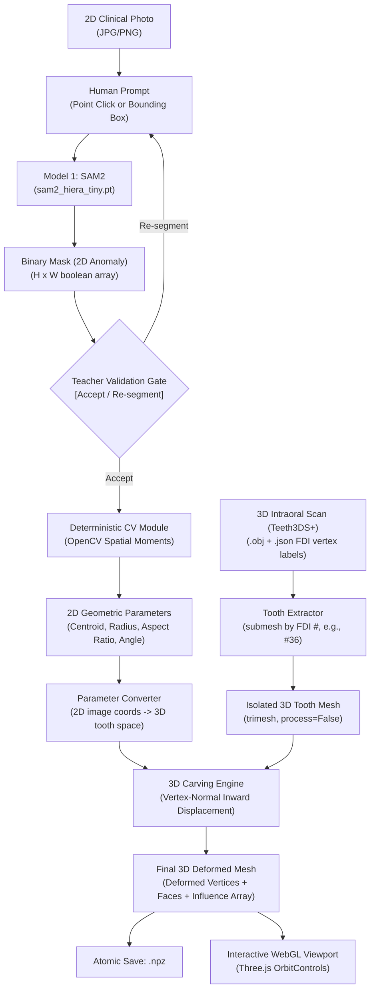

# Odonto 🦷
### AI-Assisted Dental Education & 3D Anomaly Reconstruction Platform

**Odonto** is a dental education platform where dental students and educators practice diagnosing and restoring dental pathologies on real 3D patient tooth scans. Using a **Single-Anomaly, Human-in-the-Loop (HITL)** pipeline, teachers upload or select clinical macro photographs, prompt **SAM2** to isolate anomalies, validate the geometry, and carve realistic, topology-preserving pathologies directly onto 3D patient dental meshes rendered interactively in WebGL.

---

## 🌟 End-to-End Pipeline Architecture



---

## 🚀 Key Pipeline Stages

### 1. Class-Agnostic Single-Anomaly Segmentation (SAM2)
- **Engine**: Meta's Segment Anything Model 2 (`sam2_hiera_tiny.pt`).
- **Human-in-the-Loop**: Multi-class detection models often suffer from class imbalance and demineralization boundary ambiguity. Instead, Odonto uses a promptable, class-agnostic foundation model. The teacher simply clicks on the lesion or draws a bounding box.
- **Output**: An exact 2D binary mask ($H \times W$) isolating the specific anomaly.

### 2. Teacher Validation Decision Gate
- Before any downstream processing occurs, the teacher reviews the overlay.
- **`[ ACCEPT SEGMENTATION ]`**: Promotes the prediction to `validated_mask`.
- **`[ RE-SEGMENT ]`**: Allows new click/box guidance if the mask under-segments or spills across tooth boundaries.

### 3. Deterministic 2D Geometry Extraction (OpenCV)
- Computes spatial moments ($\mu_{pq}$) and contours directly via computer vision—**zero LLM involvement in geometric calculations**:
  - **Centroid** $(C_x, C_y)$ and normalized relative position.
  - **Surface Area** and equivalent circular radius ($r = \sqrt{\text{Area}/\pi}$).
  - **Aspect Ratio** (major axis / minor axis) and **Orientation Angle** ($\theta \in [-90^\circ, +90^\circ]$) to represent elongated cracks and fissure caries.

### 4. FDI Tooth-Type-Aware 2D-to-3D Parameter Conversion (`parameter_converter.py`)
- **Anatomical Frame & Target Surface Selection**: Classifies any permanent FDI tooth (`#11–#47`) into its anatomical group:
  - **Anterior (`incisor`, `canine`)**: Targets the **labial/facial surface** (`labial_facial`, normal alignment $\ge 0.45$, central $20\%\text{--}80\%$ crown height band).
  - **Posterior (`premolar`, `molar`)**: Targets the **occlusal fossa/table** (`occlusal_table`, normal alignment $\ge 0.35$, inner $65\%$ horizontal radial core, local Laplacian concavity pit-seeking so bicuspid buccal cusp tips are never erroneously selected).
- **Dynamic Mesh-Grounded Scaling vs. Clinical Heuristic Depth Multipliers**:
  - **Measured from the 3D Mesh**: Target surface span ($S_{\text{surf}}$ via 5th–95th percentile extent) and local cross-sectional wall thickness ($T_{\text{wall}}$ via `measure_local_slice_thickness` within a $\pm 1.2\,\text{mm}$ vertical band around the target center) are **measured directly from each individual Teeth3DS+ tooth mesh**.
  - **Clinical Heuristic Depth & Profile Parameters**: Because Teeth3DS+ provides no lesion-depth ground truth and single 2D clinical photos lack metric depth, the depth-ratio multipliers and profile exponents are **clinical heuristics applied to those measured mesh bounds** (not empirically fitted from patient lesion-depth scans):
    - **Cavity**: $r_{3\text{D}} = \text{clip}(3.8 \cdot r_{\text{rel}} \cdot S_{\text{surf}},\; 0.08 S_{\text{surf}},\; 0.32 S_{\text{surf}})$, depth $d_{3\text{D}} = \min(0.42 \cdot r_{3\text{D}},\; 0.15 \cdot T_{\text{wall}})$, profile $\left[\max(0, 1 - d_i)\right]^{2.0}$.
    - **Anterior Abrasion**: $r_{3\text{D}} = \text{clip}(3.2 \cdot r_{\text{rel}} \cdot S_{\text{surf}},\; 0.12 S_{\text{surf}},\; 0.38 S_{\text{surf}})$, depth $d_{3\text{D}} = \min(0.20 \cdot r_{3\text{D}},\; 0.08 \cdot T_{\text{wall}})$, saucer profile $\left[\max(0, 1 - d_i^{2.5})\right]^{1.5}$.

### 5. 3D Patient Scan Ingestion & Tooth Isolation
- **Dataset**: Real intraoral 3D scans from **Teeth3DS+** (`.obj` meshes with companion per-vertex FDI tooth number `.json` files).
- **Submesh Filtering**: Submeshes are isolated by FDI tooth number (`#11–#47`) using `trimesh.load(..., process=False)` to preserve exact vertex ordering.

### 6. Surface-Normal-Gated, Topology-Preserving 3D Carving (`tooth_carver.py`)
- Rather than raw 3D Euclidean balls (which bleed through thin incisor/canine lingual walls), anomalies are carved via **Tangent-Plane Anisotropic Distance + Geodesic Connected-Component Filtering + Surface-Normal Alignment Gating** ($\mathbf{n}_i \cdot \mathbf{n}_{\text{center}} > 0.15$):
  $$V_{i, \text{new}} = V_i - \mathbf{n}_i \cdot \left(d_{3\text{D}} \times w_{\text{normal}}(\mathbf{n}_i \cdot \mathbf{n}_c) \times f_{\text{profile}}(d_i)\right)$$
- **Verified Zero Bleed-Through**: Across all 8 Phase 0 tooth $\times$ anomaly matrix cases and all 8 FDI premolars (`#14, #15, #24, #25, #34, #35, #44, #45`), opposite-wall bleed-through is **0 vertices** (down from 337 before Phase 0), with 100% vertex/face preservation.

### 7. Phase 0 Whitelist (`whitelist.py`) & Clinical Simulation Rooms (`app.py`)
- **Authoritative Whitelist Source of Truth (`whitelist.py`)**:
  - **Unconditional GO (Allowed in Rooms)**:
    - `Cavity` / `Caries` across all 4 validated tooth types: `incisor`, `canine`, `premolar`, and `molar` (`#11–#17, #21–#27, #31–#37, #41–#47`).
    - `Abrasion` **ONLY** on validated anterior labial surfaces: `incisor` (`#11, #12, #21, #22, #31, #32, #41, #42`) and `canine` (`#13, #23, #33, #43`).
  - **Excluded / Blocked (`HTTP 422`)**:
    - **Posterior `Abrasion`** on premolars and molars (`POSTERIOR_ABRASION_EXCLUDED`): While numerically stable (`0` bleed-through), inward radial displacement produces concave saucer depressions rather than planar occlusal attrition facets. Left out of the room feature until planar half-space clipping is implemented.
    - **Third Molars (`#18, #28, #38, #48`)** and **unvalidated anomalies** (`Crack`, `Crowding`, `Diastema`, `Rotation`, `Agenesis`, etc.).
- **Stitch `Clinical Precision` 5-View Room Interface (`templates/index.html`)**:
  1. **Case Library**: Filterable by arch quadrant (`Q1–Q4`), tooth morphology, Phase 0 approved anomaly, and clinical rigor, plus the Teacher HITL `"Generate new case"` modal.
  2. **3D Viewer & Sim**: Live Three.js WebGL tooth mesh (`OrbitControls`, wireframe, heatmap toggle, `.OBJ`/`.NPZ` export) paired with the Patient Clinical Vignette dossier.
  3. **Evaluate the AI**: 3-step diagnostic training workflow (`Step 1: Blind 3D Raycast Anomaly Marking` $\rightarrow$ `Step 2: AI Heatmap Overlay & Clinical Rationale Audit` $\rightarrow$ `Step 3: Rule-Based Score A Spatial Concordance + LLM-Driven Score B Clinical Critique + Spoken Piper TTS Teach-Back`).
  4. **Voice Viva Session**: Real-audio virtual patient dialogue (`Browser Mic / Audio Upload` $\rightarrow$ `faster-whisper STT` $\rightarrow$ `Anthropic Claude / Local Ollama LLM` $\rightarrow$ `Piper ONNX TTS WAV`) with dynamic 4-competency OSCE tracking (`Onset`, `Triggers`, `Duration`, `Medical History`).
  5. **Results, Longitudinal Progress & Teacher Dashboard**:
     - Role-authenticated (`Flask-Login` + `bcrypt`) Teacher and Student accounts with isolated room join codes (`OD-XXXXX`).
     - Per-attempt persistent Student Report (3D spatial error, diagnosis grading, full voice transcript, spoken AI teach-back, elapsed time).
     - Longitudinal Progress & Dynamic Whitelist Competency-Coverage matrix (`6` approved families, `40` FDI combinations).
     - Teacher Dashboard with per-room student completion, class analytics, and single-attempt replay modal.

---

## 📂 Project Structure

```text
├── app.py                           # Flask web server, Auth (Flask-Login + bcrypt), Dynamic Rooms & Whitelist Guard
├── db.py                            # SQLite persistence layer (users, rooms, enrollments, cases, attempts, analytics)
├── voice_llm_service.py             # Real STT (faster-whisper), LLM (Claude/Ollama), TTS (Piper ONNX) & Rule-Based 3D Grading
├── whitelist.py                     # Authoritative Phase 0 Tooth x Anomaly Whitelist
├── sam2_segmenter.py                # SAM2 image predictor wrapper
├── geometry_extractor.py            # Deterministic OpenCV geometry & moment calculations
├── parameter_converter.py           # FDI tooth-type-aware 2D-to-3D metric parameter converter
├── tooth_carver.py                  # Surface-normal-gated 3D inward displacement carving engine
├── 20_run_validation_matrix.py      # Phase 0 4x2 Tooth x Anomaly validation matrix runner
├── 21_verify_phase0_confirmations.py# Premolar generalization & wall-thickness verification
├── 23_verify_full_platform.py       # 25-check end-to-end verification suite (Auth, Rooms, Blind 3D, Audio Viva, Grading)
├── models/
│   └── piper/                       # Local Piper ONNX TTS voice model (en_US-lessac-low.onnx)
├── templates/
│   └── index.html                   # Stitch Clinical Precision Multi-Role Room, Voice Viva & Teacher Dashboard UI
├── static/
│   ├── audio/                       # Synthesized Piper TTS .wav responses and teach-back explanations
│   └── renders/phase0/              # Pre-seeded Phase 0 validated .npz, .obj, and .png assets
├── validation_matrix_report.md      # Phase 0 audit & 4x2 validation matrix report
└── matrix_validation_results.csv    # Quantitative telemetry for all Phase 0 matrix runs
```

---

## 🛠️ Quickstart Guide

### 1. Prerequisites & Virtual Environment
```bash
# Clone the repository
git clone https://github.com/Dipesh-MK/Odonto.git
cd Odonto

# Activate Python virtual environment
source venv/bin/activate

# Install dependencies
pip install -r requirements.txt
```

### 2. Launch the Web Platform
```bash
python app.py
```
Open your browser and navigate to:
👉 **`http://localhost:5000`**

### 3. Inspect Full 3D Dental Jaws (Desktop Viewer)
To visualize a full patient jaw with every tooth labeled by its FDI number:
```bash
python 06_view_one.py
```

---

## 🔒 Hard-Won Engineering Principles

1. **Always use `trimesh.load(path, process=False)`**: Never use raw VTK or PyVista OBJ readers on intraoral scan files. VTK's OBJ parser chokes on vertex-color columns and silently corrupts vertex counts.
2. **Never rely on OBJ export/import round-trips**: Preserving vertex-level label alignment requires atomic `.npz` storage (`vertices`, `faces`, `gt_mask`).
3. **No Unvalidated Masks**: The downstream 3D pipeline strictly requires explicit teacher acceptance before initiating 3D deformations.

---

## 📄 License
Educational & Research Use — Project Odonto.
