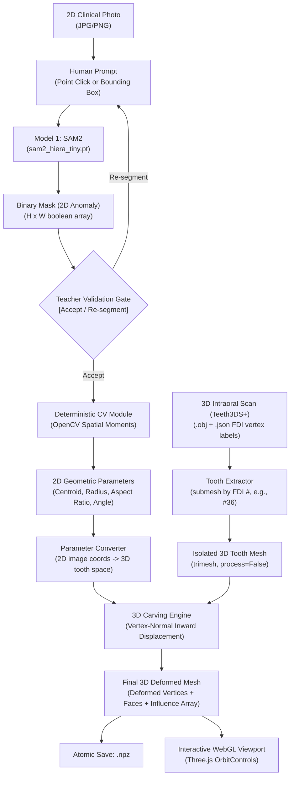

# Odonto 🦷
### AI-Assisted Dental Education & 3D Anomaly Reconstruction Platform

**Odonto** is a dental education platform where dental students and educators practice diagnosing and restoring dental pathologies on real 3D patient tooth scans. Using a **Single-Anomaly, Human-in-the-Loop (HITL)** pipeline, teachers upload or select clinical macro photographs, prompt **SAM2** to isolate anomalies, validate the geometry, and carve realistic, topology-preserving pathologies directly onto 3D patient dental meshes rendered interactively in WebGL.

---

## 🌟 End-to-End Pipeline Architecture



---

## 🚀 Key Pipeline Stages

### 1. Class-Agnostic Single-Anomaly Segmentation (SAM2)
- **Engine**: Meta's Segment Anything Model 2 (`sam2_hiera_tiny.pt`).
- **Human-in-the-Loop**: Multi-class detection models often suffer from class imbalance and demineralization boundary ambiguity. Instead, Odonto uses a promptable, class-agnostic foundation model. The teacher simply clicks on the lesion or draws a bounding box.
- **Output**: An exact 2D binary mask ($H \times W$) isolating the specific anomaly.

### 2. Teacher Validation Decision Gate
- Before any downstream processing occurs, the teacher reviews the overlay.
- **`[ ACCEPT SEGMENTATION ]`**: Promotes the prediction to `validated_mask`.
- **`[ RE-SEGMENT ]`**: Allows new click/box guidance if the mask under-segments or spills across tooth boundaries.

### 3. Deterministic 2D Geometry Extraction (OpenCV)
- Computes spatial moments ($\mu_{pq}$) and contours directly via computer vision—**zero LLM involvement in geometric calculations**:
  - **Centroid** $(C_x, C_y)$ and normalized relative position.
  - **Surface Area** and equivalent circular radius ($r = \sqrt{\text{Area}/\pi}$).
  - **Aspect Ratio** (major axis / minor axis) and **Orientation Angle** ($\theta \in [-90^\circ, +90^\circ]$) to represent elongated cracks and fissure caries.

### 4. 2D-to-3D Metric Parameter Conversion
- Projects 2D normalized coordinates onto the 3D tooth crown (top 25% $Z$-height).
- Scales pixel radius to 3D metric units (clamped between $0.6\,\text{mm}$ and $4.0\,\text{mm}$).
- Applies a physiological depth ratio (`DEFAULT_DEPTH_RATIO = 0.08`, $\approx 0.8\text{--}1.2\,\text{mm}$), avoiding arbitrary single-photo depth hallucinations.

### 5. 3D Patient Scan Ingestion & Tooth Isolation
- **Dataset**: Real intraoral 3D scans from **Teeth3DS+** (`.obj` meshes with companion per-vertex FDI tooth number `.json` files).
- **Submesh Filtering**: Submeshes are isolated by FDI tooth number (e.g., `#36` for lower left first molar) using `trimesh.load(..., process=False)` to prevent vertex reordering.

### 6. Topology-Preserving 3D Inward Carving
- Rather than destructive CSG boolean operations, anomalies are carved via **Vertex-Normal Inward Displacement with Smooth Anisotropic Falloff**:
  $$V_{i, \text{new}} = V_i - \mathbf{n}_i \cdot \left(\text{depth} \times \left[\max(0, 1 - d_i)\right]^2\right)$$
- **Benefits**:
  - 100% preservation of vertex count and triangular face connectivity.
  - The displacement influence array ($0.0 \to 1.0$) serves as the permanent 3D ground-truth anomaly mask.
  - Saved atomically as `.npz` (`vertices`, `faces`, `gt_mask`, `metadata`).

### 7. Interactive WebGL 3D Viewport (Three.js)
- Renders the carved tooth directly in the browser via Three.js with `OrbitControls`:
  - **Left-click + drag**: Orbit / 360° rotation.
  - **Right-click + drag**: Pan.
  - **Scroll**: Zoom.
  - **Dynamic Vertex Coloring**: Healthy enamel rendered in Ivory (`#f8f6f0`), carved lesion smoothly shaded to Deep Crimson (`#dc2626`).
  - **Camera Presets**: Quick snaps to Occlusal (Top), Buccal (Front), Auto-Rotate, and Wireframe inspection.

---

## 📂 Project Structure

```text
├── app.py                           # Flask web server & REST API
├── sam2_segmenter.py                # SAM2 image predictor wrapper
├── geometry_extractor.py            # Deterministic OpenCV geometry & moment calculations
├── parameter_converter.py           # 2D pixel to 3D metric coordinate converter
├── tooth_carver.py                  # 3D vertex-normal inward displacement carving engine
├── 06_view_one.py                   # PyVista 3D jaw inspection script with FDI labels
├── 07_extract_tooth.py              # Tooth isolation submesh script
├── 08_carve_cavity.py               # Core standalone cavity carver
├── templates/
│   └── index.html                   # Human-in-the-Loop Web UI
├── static/
│   └── js/
│       ├── three.min.js             # Local Three.js library
│       └── OrbitControls.js         # Three.js camera controls
├── jaw_3d_view.png                  # Sample 3D jaw segmentation render
├── odonto_hitl_mvp_report.pdf       # Comprehensive PDF technical review report
└── dental_manifest_part1.csv        # Teeth3DS+ scan manifest
```

---

## 🛠️ Quickstart Guide

### 1. Prerequisites & Virtual Environment
```bash
# Clone the repository
git clone https://github.com/Dipesh-MK/Odonto.git
cd Odonto

# Activate Python virtual environment
source venv/bin/activate

# Install dependencies
pip install -r requirements.txt
```

### 2. Launch the Web Platform
```bash
python app.py
```
Open your browser and navigate to:
👉 **`http://localhost:5000`**

### 3. Inspect Full 3D Dental Jaws (Desktop Viewer)
To visualize a full patient jaw with every tooth labeled by its FDI number:
```bash
python 06_view_one.py
```

---

## 🔒 Hard-Won Engineering Principles

1. **Always use `trimesh.load(path, process=False)`**: Never use raw VTK or PyVista OBJ readers on intraoral scan files. VTK's OBJ parser chokes on vertex-color columns and silently corrupts vertex counts.
2. **Never rely on OBJ export/import round-trips**: Preserving vertex-level label alignment requires atomic `.npz` storage (`vertices`, `faces`, `gt_mask`).
3. **No Unvalidated Masks**: The downstream 3D pipeline strictly requires explicit teacher acceptance before initiating 3D deformations.

---

## 📄 License
Educational & Research Use — Project Odonto.
